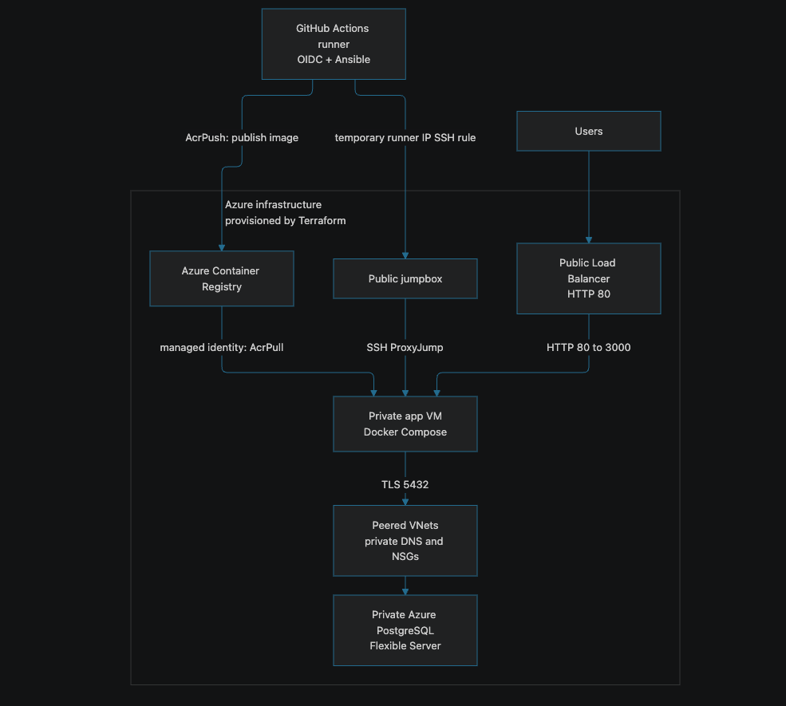

# SokoPulse

> Real-Time Agricultural Commodity Price Tracker, USSD Gateway & MoMo Trade Simulator for East African Smallholder Farmers

[](https://github.com/MohamDah/alu-devops-sokopulse/actions/workflows/ci.yml)

## African Context

Many smallholder farmers in Rwanda and across East Africa sell at the farm gate without knowing what their crop fetches in town. Buyers and traders who travel between markets know the going rates, the farmer usually does not, and that gap in information (price asymmetry) makes it hard to tell a fair offer from a low one. Prices also differ from market to market, so the same bag of beans can be worth more in Kigali than in Rubavu.

Middlemen provide real services such as transport, aggregation and storage. But when only one side knows the market price, a farmer with perishable produce and bills to pay has little room to negotiate and can end up underpaid. Simple, trusted price information is a first step towards fairer bargaining, especially when a farmer can compare several markets and see which one pays the most.

Most rural farmers use basic feature phones, not smartphones, and mobile data can be expensive or patchy. USSD menus (dial a short code such as `*182#`) work on any handset with no internet connection, which is why a price service has to be reachable that way. Once a price is agreed, mobile money (MoMo) lets the buyer pay the farmer instantly instead of carrying cash, and the farmer sees exactly what arrives after fees.

SokoPulse is a learning project that simulates this chain: compare prices, check them over USSD, and settle a trade by MoMo. It uses illustrative data only. It is not connected to any real market feed, telecom operator or payment provider.

## Team Members

| Name | Role | Student ID |
| --- | --- | --- |
| Mohamed Dahab | DevOps & Governance | m.dahab@alustudent.com |
| Promesse Irakoze | Price Service | p.irakoze2@alustudent.com |
| Christian Ishimwe Ntwali | USSD & MoMo Services | c.ishimwent@alustudent.com |
| Samuella Ineza | Dashboard & Docs | s.ineza@alustudent.com |

## Project Overview

SokoPulse is a small Node.js web application with three independent services: a commodity price tracker, a USSD menu simulator and a mobile money payment simulator. A single-page dashboard lets you try all three in a browser. Market prices use seeded in-memory data. MoMo transactions use in-memory storage by default, or PostgreSQL when `DATABASE_URL` is configured.

The application is deliberately simple. The focus of the course project is the DevOps practice around it: protected branches, code review, automated tests, CI, containers and infrastructure as code. Each service lives in its own folder under `src/services/` with its own routes, logic and data, so it can later be split into a separate container (LO7 microservices readiness).

Formative 1 set up the app and team workflow. Formative 2 added Docker and CI. For Formative 3, Terraform creates an Azure VM, Ansible configures and deploys the app, and CI checks dependencies, the container image and Terraform for security findings.

### Target Users

- **Smallholder farmers and cooperatives:** compare prices across markets and see where to sell.
- **Produce buyers:** check an agreed price and preview the fee and the farmer's net payout.
- **Students and instructors:** a small, readable codebase for practising Git workflow, testing and DevOps tooling.

### Core Features

1. **Commodity price tracker:** `GET /api/prices` returns 5 commodities (Maize, Red Beans, Irish Potatoes, Cassava, Rice) across 4 markets (Kimironko-Kigali, Musanze, Rubavu, Huye) in RWF/kg, with wholesale and retail prices, trend and filters.
2. **Arbitrage engine:** `GET /api/prices/arbitrage?commodity=Maize` returns the best market to sell, the lowest-priced market, the spread and trend percentages.
3. **USSD menu simulator:** `POST /api/ussd` serves a 3-level `*182#` menu (main menu, crop, market, live price) using `CON` and `END` screens.
4. **MoMo payment simulator:** `POST /api/momo/pay` validates Rwandan phone numbers, calculates subtotal, tiered fee and net farmer payout, and returns a simulated reference with deterministic success or failure.

## Technology Stack

| Layer | Technology |
| --- | --- |
| Backend | Node.js 20+, Express 5, JavaScript (CommonJS), Helmet, dotenv |
| Frontend | Plain HTML, CSS and JavaScript (no framework, no build step) |
| Database / data layer | Seeded in-memory market data; MoMo transactions in memory by default or PostgreSQL with `DATABASE_URL` |
| Testing & DevOps | Jest, Supertest, ESLint, GitHub Actions, Docker, Docker Compose, npm audit, Trivy, Terraform, Ansible, Azure and GitHub (branch protection, CODEOWNERS, PR template) |

## Getting Started

### Prerequisites

- Node.js 20 or later and npm
- Git
- Docker Desktop (optional, only for the Docker Compose route)
- `curl` (optional, for the API examples)

### Installation

```bash
git clone https://github.com/MohamDah/alu-devops-sokopulse.git
cd alu-devops-sokopulse
npm install
cp .env.example .env
npm test
npm start
```

Open http://localhost:3000 for the dashboard. With the example `.env`, the app uses in-memory transaction storage and data resets on restart. To persist MoMo transactions, set `DATABASE_URL` to a PostgreSQL connection string; the app creates its transaction table at startup. `DB_SSL` defaults to `true`; set it to `false` only for a local PostgreSQL instance that does not use TLS. Use `npm run test:coverage` for a coverage report.

### Usage

Prices (optionally filtered), and the arbitrage comparison:

```bash
curl "http://localhost:3000/api/prices"
curl "http://localhost:3000/api/prices?commodity=Maize&market=Musanze"
curl "http://localhost:3000/api/prices/arbitrage?commodity=Maize"
```

USSD: send the choices so far, joined by `*`. Start with an empty `text`.

```bash
curl -X POST http://localhost:3000/api/ussd -H "Content-Type: application/json" -d '{"text":""}'
curl -X POST http://localhost:3000/api/ussd -H "Content-Type: application/json" -d '{"text":"1*1*1"}'
```

The second call (prices, Maize, Kimironko-Kigali) returns an `END` screen with the live price. Responses starting `CON` expect another choice; `END` closes the session. Choice `0` exits.

About `*182#`:

- **It is a label, not parsed.** The dial string is never sent to the API. A real USSD gateway starts the session when the user dials the code, then sends only the choices made so far as `text` (for example `"1*1*1"`). This simulator takes that `text` directly.
- **MoMo-style shortcuts work the same way.** A shortcut such as `*182*1*1*1#` reaches a gateway as `text = "1*1*1"`. The service keeps no session, so sending `"1*1*1"` as the first request already works. We don't simulate the gateway stripping `*182*` and `#`.
- **`*182#` is a real code.** It is MTN Rwanda's MoMo code, used here only as a demo label. A real deployment would need its own operator-assigned shortcode.
- **USSD is not connected to MoMo.** The menu shows prices and the best market to sell. Payments are only available at `/api/momo/pay` and in the dashboard.

MoMo payment simulation (25 kg x 1,200 RWF = 30,000 RWF, fee 300, net payout 29,700):

```bash
curl -X POST http://localhost:3000/api/momo/pay -H "Content-Type: application/json" \
  -d '{"buyerPhone":"0781234567","farmerPhone":"0791234567","commodity":"Red Beans","quantityKg":25,"pricePerKg":1200}'
curl "http://localhost:3000/api/momo/transactions"
```

When PostgreSQL is configured, this transaction list is retained across application restarts. Without `DATABASE_URL`, it is kept in memory and resets on restart.

Set `"scenario"` to `insufficient_funds` or `pin_timeout` for a deterministic failed payment (still returned as HTTP 201 with `"status":"FAILED"`). Invalid input returns HTTP 400. Fee tiers (simulated, deducted from the farmer): up to 5,000 RWF = 50; up to 50,000 = 300; up to 500,000 = 1,500; above = 5,000.

### Run with Docker Compose

Docker packages the app so it runs the same on every machine. You only need Docker Desktop (or Docker Engine with the Compose plugin); Node.js is not required for this route.

```bash
cp .env.example .env        # optional: sets the port on your machine
docker compose up --build
```

Open http://localhost:3000. Useful commands:

```bash
docker compose ps           # shows the container and its health (healthy)
docker compose logs -f      # follow the app logs
docker compose down         # stop and remove the container
```

How it is set up:

- **`Dockerfile`:** two stages on `node:20-alpine`. The first installs production dependencies, the second is a small runtime image. It runs as the non-root `node` user and has a health check on `/api/health`.
- **`docker-compose.yml`:** one `app` service built from the Dockerfile, with a restart policy, a health check and a named network.
- **Port:** the app always listens on 3000 inside the container. To use another port on your machine, set `PORT` in `.env` (for example `PORT=8080`) and open http://localhost:8080.
- **Data:** no database container is included. The app uses in-memory transactions unless a PostgreSQL `DATABASE_URL` is supplied through `.env`; an external database keeps transactions across container restarts.
- **`.dockerignore`:** keeps `node_modules`, `.env` files, tests and docs out of the image.

## Azure Infrastructure

### Summative Terraform

The Terraform root describes the Azure stack: a public jumpbox restricted to the
admin CIDR, a private app VM behind a Standard Load Balancer, and an
authenticated Azure Container Registry. MoMo transactions are stored in Azure
Database for PostgreSQL Flexible Server. It runs in Spain Central because South
Africa North had no PostgreSQL capacity, and the app reaches it privately over
VNet peering and TLS. See the [Terraform guide](terraform/README.md) for the
architecture and inputs.

Ansible deploys the app container to the private VM through the jumpbox. See [the Ansible guide](ansible/README.md) for deployment steps.

**Live demo:** [http://102.37.104.41/](http://102.37.104.41/) — HTTP only;
use synthetic data and do not enter real payment details.

**Demo video:** [https://youtu.be/2MLivKSLMaI](https://youtu.be/2MLivKSLMaI).

The main-branch CD workflow has completed a successful end-to-end run,
including deployment and Ansible verification. See
[the successful GitHub Actions run](https://github.com/MohamDah/alu-devops-sokopulse/actions/runs/45231947887).

Azure infrastructure and deployment wiring:



### Formative 3 deployment (historical)

Formative 3 used one public Ubuntu VM, with Ansible deploying the app container
to port 3000. Our [Ansible PR](https://github.com/MohamDah/alu-devops-sokopulse/pull/28)
records a successful deployment: the first playbook run reported `changed=10`,
the second `changed=0`, and verification passed. That is evidence of that run,
not a guarantee that the VM is still online.

Terraform state, private keys, real variable files and image archives stay off
Git. The original deployment was a short-lived HTTP demo, not a production
service; use synthetic data only. Read [the security findings and accepted
risks](SECURITY.md) before exposing it.

## Continuous Integration

A GitHub Actions workflow ([`.github/workflows/ci.yml`](.github/workflows/ci.yml)) checks every change automatically.

**When it runs:** on pushes to any branch except `main`, and on pull requests into `main`.

**What it does** (one job named `ci`):

1. Check out the code
2. Set up Node.js 20 (with the npm cache)
3. Install dependencies with `npm ci`
4. Scan dependencies (`npm audit --audit-level=high`)
5. Lint with ESLint (`npm run lint`)
6. Run the Jest tests (`npm test`)
7. Build the Docker image
8. Scan the image with Trivy (fixable HIGH and CRITICAL vulnerabilities fail)
9. Scan Terraform with Trivy (HIGH and CRITICAL misconfigurations fail)

The image scan waits for the build and earlier checks to pass. The Terraform
scan still runs after an earlier failure, unless the workflow is cancelled.
All three scan types are configured on every PR into `main`.
See [SECURITY.md](SECURITY.md) for the findings, thresholds and HTTP exception.

**Run the same checks locally** before you push:

```bash
npm ci
npm audit --audit-level=high
npm run lint
npm test
docker build -t sokopulse:ci .
```

**Merging:** the `ci` check is required on `main` (see the table below). A pull request cannot be merged while it is failing, and a failed lint step skips the tests, Docker build and image scan. The Terraform scan still runs. The CI badge at the top links to the workflow; check the PR's own results before merging.

## Continuous Deployment

The [CD workflow](.github/workflows/cd.yml) runs on pushes to `main` (normally
after a protected pull request is merged). It repeats the tests and scans,
builds an AMD64 image tagged with the full commit SHA, pushes it to ACR, then
deploys and verifies it through Ansible. It completed successfully on
24 November 2026; see [run 4](https://github.com/MohamDah/alu-devops-sokopulse/actions/runs/45231947887).
Opening a pull request runs CI, not CD.

The workflow uses repository variables and secrets configured under
**Repository Settings → Secrets and variables → Actions**. Keep values and
credentials out of Git; update the configuration if the infrastructure or
identity changes.

**Repository variables**

| Variable | Value |
|---|---|
| `AZURE_CLIENT_ID` | Entra application/service-principal client ID for GitHub OIDC |
| `AZURE_TENANT_ID` | Azure tenant ID |
| `AZURE_SUBSCRIPTION_ID` | Azure subscription ID |
| `AZURE_RESOURCE_GROUP` | Resource group containing the jumpbox, NSG and ACR |
| `JUMPBOX_NSG_NAME` | Jumpbox network security group name |
| `ACR_NAME` | Azure Container Registry name |
| `ACR_LOGIN_SERVER` | ACR login server, for example `example.azurecr.io` |
| `JUMPBOX_PUBLIC_IP` | Jumpbox public IPv4 address |
| `APP_PRIVATE_IP` | App VM private IPv4 address |
| `APP_URL` | Public application URL |
| `JUMPBOX_CIDR` | App-side SSH-allowed jumpbox subnet in CIDR notation |
| `ADMIN_USERNAME` | SSH username configured on both VMs |
| `DB_HOST` | Private PostgreSQL server hostname |
| `DB_NAME` | PostgreSQL database name |
| `DB_USER` | PostgreSQL user |

**Repository secrets**

| Secret | Value |
|---|---|
| `DATABASE_ADMIN_PASSWORD` | PostgreSQL password; follow the Terraform password policy |
| `DEPLOY_SSH_PRIVATE_KEY` | Private key matching the public key installed on both VMs |
| `JUMPBOX_KNOWN_HOSTS` | Verified jumpbox host-key entry or entries |
| `APP_KNOWN_HOSTS` | Verified app VM host-key entry or entries |

The Entra federated credential trusts this repository's `main` branch; do not
use a long-lived Azure client secret. Scope `AcrPush` to the ACR and
`Network Contributor` to the jumpbox NSG for the GitHub identity. Verify both
SSH host keys through a trusted channel before saving them. The workflow
temporarily allows only the current runner's `/32` address to SSH to the
jumpbox, removes that rule after deployment, and removes a stale rule at the
start of a later run if a previous runner could not clean up.

## Project Structure

```text
alu-devops-sokopulse/
├── .github/
│   ├── workflows/
│   │   ├── ci.yml              # lint, tests, build and security scans
│   │   └── cd.yml              # main-branch publish and Ansible deployment
│   ├── CODEOWNERS
│   └── pull_request_template.md
├── public/                     # dashboard (HTML, CSS, JS)
├── src/
│   ├── config/index.js         # reads PORT
│   ├── data/seedMarkets.js     # seeded price data
│   ├── services/
│   │   ├── price-service/      # price.service.js + price.routes.js
│   │   ├── ussd-service/       # ussd.service.js + ussd.routes.js
│   │   └── momo-service/       # momo.service.js + momo.routes.js
│   ├── app.js                  # builds the Express app and wires the services
│   └── server.js               # starts the server
├── tests/                      # Jest unit tests per service + API integration tests
├── terraform/                  # Azure resources, variables, outputs and runbook
├── ansible/
│   ├── inventory.sh            # reads Terraform outputs
│   ├── inventory.example.yml   # optional static inventory template
│   ├── playbook.yml
│   ├── verify.yml              # deployed server checks
│   ├── requirements.yml
│   ├── roles/                  # docker, security, registry, application
│   └── README.md
├── .dockerignore
├── .env.example
├── .gitignore
├── Dockerfile
├── LICENSE
├── SECURITY.md
├── CHANGELOG.md
├── docker-compose.yml
├── eslint.config.js
├── package.json
├── package-lock.json
└── README.md
```

How the pieces fit together:

```text
Browser dashboard / curl
          |
          v
     src/app.js  (Express)
      |       |        |
/api/prices  /api/ussd  /api/momo
      |       |        |
 price-service  ussd-service  momo-service
 (own logic     (own logic;   (own logic and
  and data)      reads prices  own transaction
                 via injected  list)
                 provider)
```

Each service folder holds its own routes and its own logic, and keeps its own data. No service imports another service's files. The only connection is in `src/app.js`, which hands the USSD service a small price-reading interface. This is what prepares the app for LO7 microservices containerization: in a later formative each folder can get its own entry point and Dockerfile, and the injected price interface can become an HTTP call to the price container behind an API gateway, without rewriting the service logic.


## Security & Branch Protection Governance (Shift-Left DevOps)

`main` is protected. Nothing reaches it except through a reviewed pull request. The rules below are enabled on the repository (Settings > Branches).

| Rule | Setting on `main` | Why it matters |
| --- | --- | --- |
| Require pull request | On | Every change is proposed, discussed and recorded; nobody pushes straight to `main`. |
| 1 approval | At least 1 approving review | A second person sees every change, which shares knowledge and catches mistakes. |
| Dismiss stale approvals | On | If new commits are pushed, the earlier approval no longer counts; reviewers approve what actually merges. |
| Status checks | On (strict). The `ci` check (lint, tests, Docker build and security scans) is required | A change cannot merge unless the automated checks pass, so verification does not depend on one person's local run. |
| Up-to-date branches | On | A branch must include the latest `main` before merging, so it is tested against current code. |
| Conversation resolution | On | Review comments must be resolved, not ignored. |
| Include administrators | On | The owner follows the same rules as everyone else. Force pushes and branch deletion are also blocked. |

Supporting files: [`.github/CODEOWNERS`](.github/CODEOWNERS) lists reviewers for core directories, [`.github/pull_request_template.md`](.github/pull_request_template.md) is the PR checklist, and [`.gitignore`](.gitignore) keeps secrets (`.env`), dependencies and Terraform state out of git.

Workflow: branch from `main`, make small [Conventional Commits](https://www.conventionalcommits.org/), open a PR that links its issue, get a review, then merge.

Limits of this demo: it uses plain HTTP, with no authentication, rate limiting or persistent storage. The Azure demo intentionally allows public HTTP for assessment, but must only use synthetic data and stay short-lived. Do not enter real phone numbers or payment details. The current dependency findings are in development tooling; production dependencies reported none on 10 November 2026. Node.js 20 is end-of-life and needs a tested upgrade before any production use. See [SECURITY.md](SECURITY.md) for the details and review dates.

### AI usage disclosure

The initial codebase and documentation were produced with substantial help from an AI coding assistant (an AI assistant using Copilot SDK in VS Code). Generated code can contain mistakes, so every contributor is expected to read, test and be able to explain what they submit, and to follow the course's AI-use policy. AI assistance is not a substitute for teammate code review.

See the [AI usage annex](AI_USAGE_ANNEX.md) for prompt summaries,
output descriptions and how the assistance was used or modified.

## Links

- [Project Board](https://github.com/users/MohamDah/projects/5/views/1)
- [Documentation](./README.md)
- [Terraform setup](terraform/README.md)
- [Ansible deployment](ansible/README.md)
- [Security findings](SECURITY.md)

## License

MIT License. See [LICENSE](./LICENSE).
